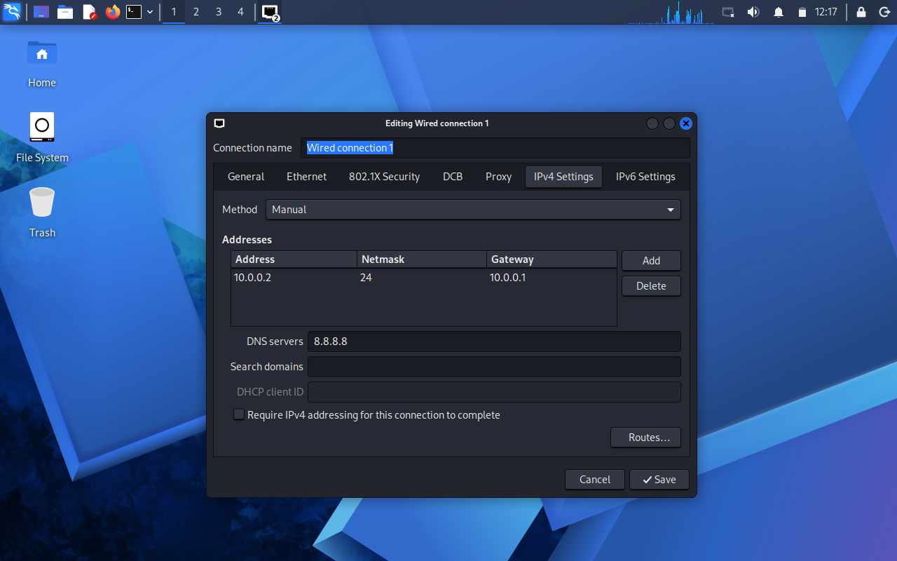

# 🐉 Kali Linux Cybersecurity Lab Setup

> Week 1 lab setup for a practical cybersecurity and networking environment.

This repository documents the configuration of a Kali Linux virtual lab using Oracle VirtualBox. The goal is to create a safe, isolated environment for learning cybersecurity workflows, networking, and Linux-based security tools.

---

## 📌 Lab Overview

The lab setup includes:

- Oracle VirtualBox
- Kali Linux 2026.2
- NAT Network configuration
- VM networking verification
- Screenshot-based setup documentation

### 🧰 Environment Details

| Component | Configuration |
| --- | --- |
| 🖥️ Hypervisor | Oracle VirtualBox |
| 🐉 OS | Kali Linux 2026.2 |
| 💻 Architecture | x64 |
| 🌐 Network Mode | NAT Network |
| 🔌 Network Name | `Lab-Network` |
| 📡 IP Range | `10.0.0.0/24` |
| 🚪 Gateway | `10.0.0.1` |
| 📦 DHCP | Enabled |
| 🧠 Memory | 2048 MB |
| ⚙️ CPU | 2 Cores |
| 💾 Storage | ~80 GB |

> The IP address may vary slightly depending on the host network and DHCP assignment.

---

## 🗺️ Lab Architecture

```text
Internet
   │
   ▼
Host Machine
   │
   ▼
Oracle VirtualBox
   │
   ▼
NAT Network: Lab-Network (10.0.0.0/24)
   │
   ▼
Kali Linux VM
   │
   └── Gateway: 10.0.0.1
```

---

## ✅ Step 1: Create the NAT Network

Open VirtualBox and go to:

```text
Network → NAT Networks
```

Create a new NAT network with:

```text
Name: Lab-Network
IPv4 Prefix: 10.0.0.0/24
DHCP: Enabled
```

### 📸 NAT Network Screenshot


---

## 🐉 Step 2: Set Up the Kali Linux VM

Create or import a Kali Linux VM and configure the following settings:

```text
Name: kali-linux-2026.2-virtualbox-amd64
OS Type: Debian (64-bit)
Memory: 2048 MB
Processors: 2
Disk: ~80 GB
```

Then set the network adapter to:

```text
Adapter 1 → NAT Network → Lab-Network
```

### 📸 Kali VM Setup Screenshots




---

## 🔌 Step 3: Verify Network Connectivity

After booting the Kali VM, run the following:

```bash
ip addr
ip route
cat /etc/resolv.conf
```

Check that the system has an IP in the `10.0.0.0/24` range and a default gateway at `10.0.0.1`.

### 📸 Network Verification


---

## 🧪 Step 4: Test Internet Access

Run:

```bash
ping -c 4 10.0.0.1
ping -c 4 8.8.8.8
ping -c 4 google.com
```

Expected results:

- Gateway reachable
- Internet connectivity available
- DNS resolution working

---

## 📋 Final Checklist

### 🌐 Network
- [ ] Create `Lab-Network`
- [ ] Configure `10.0.0.0/24`
- [ ] Enable DHCP
- [ ] Verify gateway `10.0.0.1`

### 🐉 Kali VM
- [ ] Install or import Kali Linux
- [ ] Configure adapter to NAT Network
- [ ] Start VM successfully
- [ ] Confirm network access

### 🔍 Validation
- [ ] Check IP address
- [ ] Check default gateway
- [ ] Check DNS
- [ ] Ping `8.8.8.8`
- [ ] Ping `google.com`

---

## ✅ Final Lab Status

```text
┌──────────────────────────────────┐
│     🐉 KALI LAB STATUS         │
├──────────────────────────────────┤
│ 🌐 NAT Network     ✅ Configured │
│ 🐉 Kali Linux      ✅ Installed  │
│ 🔌 Network         ✅ Verified   │
│ 📸 Setup Screens   ✅ Captured  │
│                                  │
│      🚀 LAB READY               │
└──────────────────────────────────┘
```

---

## 🚀 Next Steps

This lab can be expanded with:

- Vulnerable test machines
- Web application targets
- Linux exploitation labs
- Defensive security tooling
- Networking experiments

---

## ⚠️ Responsible Use

This environment is intended for learning and authorized testing only. Use it responsibly and only on systems you own or have permission to assess.

---

## ⭐ Project Summary

This repository represents the Week 1 cybersecurity lab setup, showing the creation of a safe Kali Linux environment and its configuration for network-based learning and experimentation.
